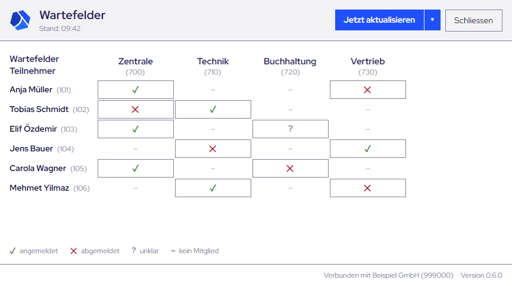
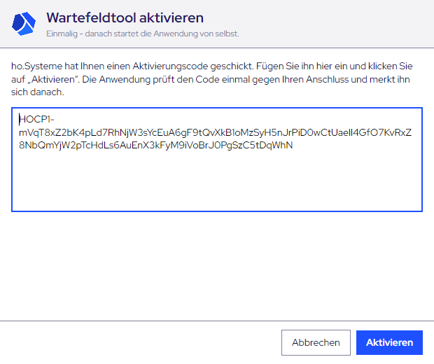
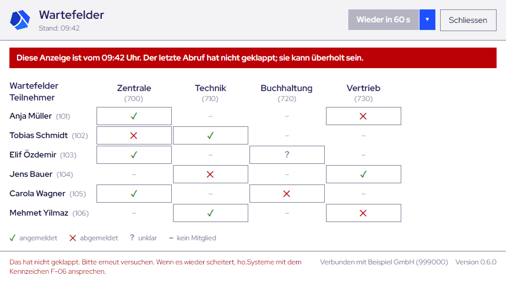
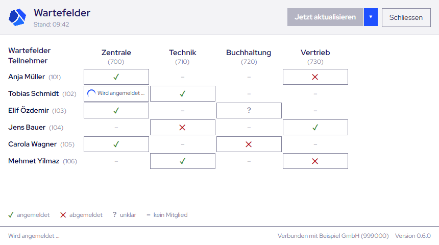
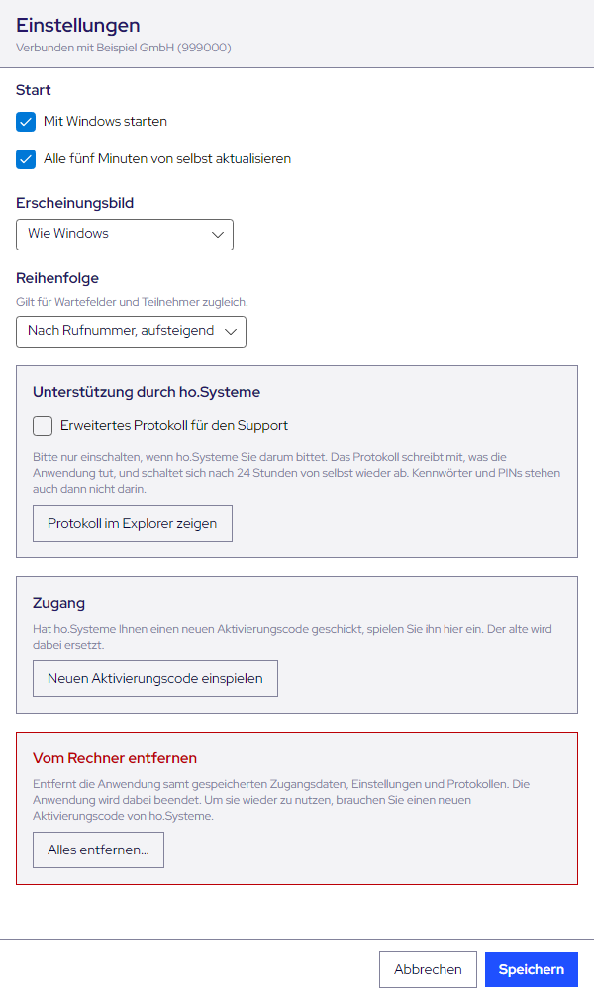
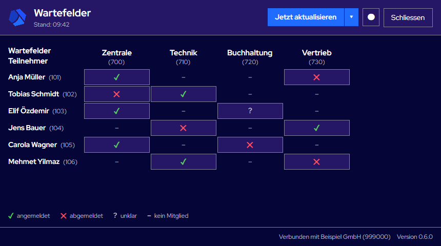
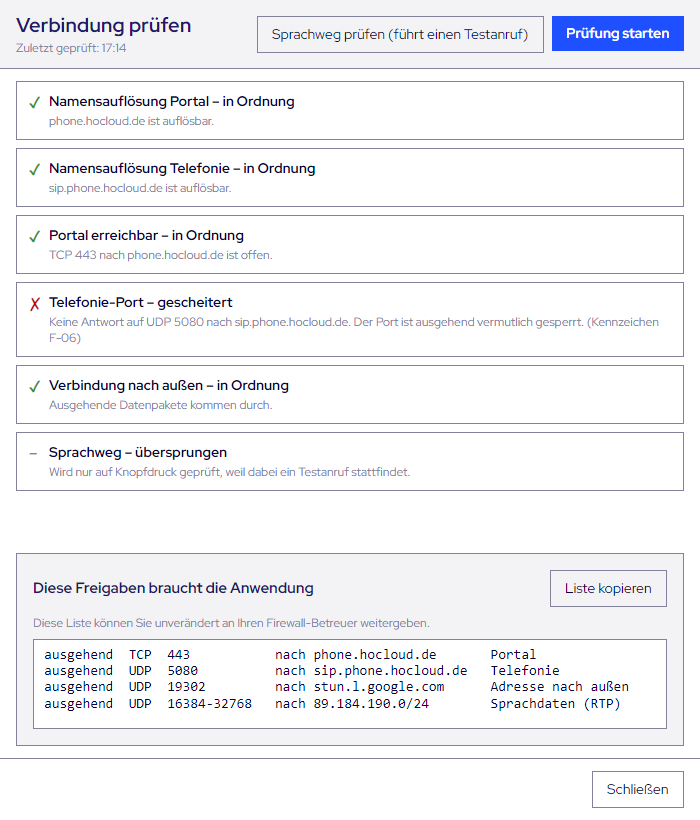

# Wartefeldtool — Anleitung

Mit dem Wartefeldtool sehen Sie auf einen Blick, wer in welchem Wartefeld
angemeldet ist. Mit einem Klick melden Sie jemanden an oder ab — ohne Telefon
in der Hand und ohne sich irgendwo anzumelden.

> Alle Namen, Wartefelder und Nummern in dieser Anleitung sind erfunden.

**Inhalt**

- [Einrichten](#einrichten)
- [Die Übersicht lesen](#die-übersicht-lesen)
- [Jemanden an- oder abmelden](#jemanden-an--oder-abmelden)
- [Einstellungen](#einstellungen)
- [Verbindung prüfen](#verbindung-prüfen)
- [Wenn etwas nicht klappt](#wenn-etwas-nicht-klappt)
- [Vom Rechner entfernen](#vom-rechner-entfernen)
- [Gut zu wissen](#gut-zu-wissen)

---

## Einrichten

Das machen Sie genau einmal. Sie brauchen dafür den **Aktivierungscode**, den
Sie von ho.Systeme bekommen haben: ein längerer Textblock, der mit `HOCP1-`
beginnt.

1. **`HOCP-Wartefeldtool.exe` starten.**

   Windows meldet beim ersten Start einen unbekannten Herausgeber. Das ist zu
   erwarten. Über *Weitere Informationen → Trotzdem ausführen* geht es weiter.

2. **Den Code einfügen und auf „Aktivieren“ klicken.**

   

   Die Prüfung dauert einen Augenblick — die Anwendung probiert den Code
   einmal an Ihrem Anschluss aus.

3. **Die Anwendung prüft, ob alles durchkommt.** Das läuft von selbst an und
   endet mit einem kurzen Testanruf.

   Kommt alles durch, geht es von selbst weiter. Bleibt ein Punkt rot,
   bleibt die Übersicht zu — sie wäre ohnehin leer. Neben jedem Punkt steht,
   woran es liegt, und darunter finden Sie die Liste der Freigaben, die Ihre
   Firewall braucht. Die können Sie mit einem Klick kopieren und an Ihren
   Firewall-Betreuer weitergeben. Danach **Prüfung starten** noch einmal
   drücken.

   Nicht jeder rote Punkt hält Sie auf. Entscheidend ist der Testanruf —
   kommt der durch, ist der Weg frei, auch wenn ein einzelner Punkt darüber
   bemängelt wird.

4. **Fertig.** Die Übersicht geht auf. Die Anwendung richtet sich auf Wunsch
   dauerhaft ein: Sie startet danach mit Windows und hält sich selbst aktuell.

Den Code brauchen Sie danach nicht mehr. Heben Sie ihn trotzdem auf, falls der
Rechner einmal neu aufgesetzt wird.

Die Anwendung läuft von da an im Infobereich neben der Uhr. Ein Klick auf das
Symbol öffnet die Übersicht.

---

## Die Übersicht lesen

Jede **Spalte** ist ein Wartefeld, jede **Zeile** ein Teilnehmer. In Klammern
steht jeweils die interne Rufnummer — praktisch, wenn zwei Leute gleich heißen.

| Zeichen | Bedeutung |
|:---:|---|
| ✓ | **angemeldet** — nimmt Anrufe aus diesem Wartefeld an |
| ✕ | **abgemeldet** — bekommt von hier gerade keine Anrufe |
| ? | **unklar** — der Zustand war nicht sicher zu erkennen |
| – | **kein Mitglied** — diese Person gehört nicht zu diesem Wartefeld |

Dieselbe Erklärung steht immer unter der Tabelle. Fahren Sie mit der Maus über
eine Zelle, sagt Ihnen ein kleiner Hinweis den ganzen Satz dazu.

Oben links steht, von wann die Anzeige ist. Sie frischt sich alle 15 Minuten
von selbst auf; mit **Jetzt aktualisieren** geht es sofort. Danach ist der Knopf
eine Minute lang gesperrt — das ist Absicht und schont die Telefonanlage.

**Wird die Anzeige einmal nicht frisch**, bleibt die alte Tabelle stehen und ein
rotes Band sagt es Ihnen deutlich:

---

## Jemanden an- oder abmelden

**Ein Klick auf die Zelle genügt.** Steht dort ein ✕, wird die Person
angemeldet; steht dort ein ✓, wird sie abgemeldet.

Das dauert ungefähr 20 Sekunden. So lange dreht sich in der Zelle ein kleiner
Kringel, unten links steht, was gerade passiert. Danach steht in der Zelle das
neue Zeichen, und unten steht ein Satz, der es bestätigt.

Gut zu wissen:

- Sie können in der Zwischenzeit **weiterklicken**. Die Aufträge werden der
  Reihe nach abgearbeitet; wartende Zellen sind ebenfalls gekennzeichnet.
- Dieselbe Zelle zweimal anzuklicken bewirkt nichts Zusätzliches.
- Zellen mit **?** lassen sich nicht anklicken. Solange nicht sicher ist, was
  gilt, wird nichts geraten — hier hilft **Jetzt aktualisieren**.

---

## Einstellungen

Sie finden sie über den kleinen Pfeil **▾** neben *Jetzt aktualisieren*.

**Mit Windows starten** — die Anwendung ist eine Aufsicht und nützt nur, wenn
sie läuft. Normalerweise eingeschaltet lassen.

**Alle 15 Minuten von selbst aktualisieren** — hält die Anzeige frisch, ohne
dass Sie etwas tun. Schalten Sie es aus, ist der Knopf *Jetzt aktualisieren*
der einzige Weg zu neuen Daten.

**Erscheinungsbild** — *Wie Windows*, *Hell* oder *Dunkel*. Das lässt sich auch
oben rechts im Hauptfenster mit einem Griff umstellen.

**Reihenfolge** — in welcher Ordnung Wartefelder und Teilnehmer stehen: nach
Rufnummer oder nach Name, auf- oder absteigend. Die Einstellung gilt für beide
zugleich, damit Spalten und Zeilen zusammenpassen.

Änderungen werden mit **Speichern** übernommen.

Im selben Fenster liegen außerdem der Knopf für einen **neuen
Aktivierungscode** (falls ho.Systeme Ihnen einen schickt) und das **erweiterte
Protokoll** — dazu gleich mehr.

---

## Verbindung prüfen

Ebenfalls hinter dem Pfeil **▾**. Hier sehen Sie Schritt für Schritt, ob Ihr
Netz die Anwendung durchlässt.

Jeder Punkt bekommt ein ✓ oder ein ✗. Ein ✗ ist kein Grund zur Sorge — es sagt
nur, an welcher Stelle es klemmt.

**Was Sie Ihrem Firewall-Betreuer geben:** die Liste unten im Fenster, über
**Liste kopieren** in die Zwischenablage und unverändert in eine Mail. Mehr
braucht er nicht; dort steht genau, was freigegeben sein muss.

Der Punkt **Sprachweg** wird hier nur geprüft, wenn Sie den Knopf dafür
drücken — dabei findet ein kurzer Testanruf statt. Alles andere läuft ohne
Nebenwirkung. Bei der Einrichtung läuft er einmal von selbst mit.

---

## Wenn etwas nicht klappt

Erscheint eine Meldung mit einem **Kennzeichen** wie `F-06` oder `F-07`, dann
nennen Sie uns bitte genau dieses. Damit wissen wir sofort, wo wir suchen
müssen — ohne Rückfragen und ohne Raten.

Zwei Dinge können Sie vorher selbst versuchen:

1. **Jetzt aktualisieren** drücken. Manches ist beim zweiten Anlauf erledigt.
2. **Verbindung prüfen** (siehe oben). Rote Punkte gehören zu Ihrem
   Firewall-Betreuer, nicht zu uns.

### Was die Kennzeichen bedeuten

Die meisten Kennzeichen betreffen Ihr Netzwerk — die können Sie zusammen mit
Ihrem Firewall-Betreuer selbst beheben. Bei allen übrigen liegt es an Ihrem
Zugang, und dann sind wir dran.

| Kennzeichen | Was dahintersteckt | Was hilft |
|---|---|---|
| **F-01** | Die Adressen lassen sich in Ihrem Netz nicht auflösen | Ihr Firewall-Betreuer: Namensauflösung (DNS) prüfen |
| **F-02** | Das Portal ist nicht erreichbar | Internetverbindung prüfen, `TCP 443` freigeben |
| **F-03** | Die Verbindung wird unterwegs aufgebrochen | Eine Firewall oder ein Proxy setzt eigene Zertifikate ein. Dafür braucht es eine Ausnahme — sonst verweigert die Anwendung die Verbindung, und das ist Absicht |
| **F-06** | Der Port für die Telefonie ist gesperrt | `UDP 5080` ausgehend freigeben |
| **F-08** | Es kommen keine Sprachdaten an | Den Bereich für Sprachdaten freigeben (siehe Liste unter *Verbindung prüfen*) |
| **F-12** | Das Portal ist gerade stark beansprucht | Nichts. Die Anwendung wartet von selbst und versucht es erneut |
| alle anderen | Etwas an Ihrem Zugang stimmt nicht mehr | Uns ansprechen und das Kennzeichen nennen. Meist genügt ein neuer Aktivierungscode |

Bei **F-04** hält die Anwendung die selbsttätige Aktualisierung an und sagt
Bescheid. Das ist kein Fehler, sondern Absicht: Ein Zugang, der abgelehnt
wird, repariert sich nicht von selbst, und immer weiter zu versuchen würde ihn
nur sperren.

### Erweitertes Protokoll

Darum bitten wir Sie nur im Einzelfall. Es schreibt mit, was die Anwendung tut,
damit wir einen seltenen Fehler nachvollziehen können.

1. *Einstellungen → Erweitertes Protokoll für den Support* einschalten,
   **Speichern**.
2. Den Fehler noch einmal auslösen.
3. *Protokoll im Explorer zeigen* — und uns die markierte Datei schicken.

Das Protokoll schaltet sich nach 24 Stunden von selbst wieder ab. **Ihre
Zugangsdaten stehen nicht darin**, auch nicht für uns.

---

## Vom Rechner entfernen

Die Anwendung steht nicht unter *Programme und Features* — sie bringt keinen
Installer mit und räumt sich deshalb selbst ab:

*Einstellungen → Vom Rechner entfernen → **Alles entfernen…*** — und zur
Sicherheit ein zweites Mal auf denselben Knopf, nachdem dort steht, was genau
verschwindet.

Entfernt werden die gespeicherten Zugangsdaten, Ihre Einstellungen, die
Protokolle und das Programm selbst. Die Anwendung schließt sich dabei. Um sie
später wieder zu benutzen, brauchen Sie einen neuen Aktivierungscode von
ho.Systeme.

Bleibt etwas stehen, sagt das Fenster es Ihnen. Sprechen Sie uns dann bitte an.

---

## Welche Fassung läuft hier?

Im Menü neben **Jetzt aktualisieren** und im Kontextmenü des Symbols neben der
Uhr finden Sie **Über**. Dort stehen die Fassung, unsere Anschrift und wie Sie
uns erreichen — dazu ein Knopf, der die Angaben in die Zwischenablage legt,
nach denen wir am Telefon fragen.

---

## Gut zu wissen

- Die Anwendung läuft auf **einem** Rechner je Firma.
- Sie **hält sich selbst aktuell**. Sie müssen nichts nachinstallieren und
  nichts von Hand herunterladen.
- Sie braucht **keine Administratorrechte**.
- Ihre Zugangsdaten stecken verschlüsselt im Aktivierungscode. Die Anwendung
  zeigt sie nie an, und im Protokoll stehen sie auch nicht.
- Ein Klick auf **Schliessen** beendet die Anwendung nicht — sie bleibt im
  Infobereich neben der Uhr und arbeitet weiter.

---

Fragen? **ho.Systeme** hilft weiter — mit dem Kennzeichen aus der Meldung geht
es am schnellsten.
